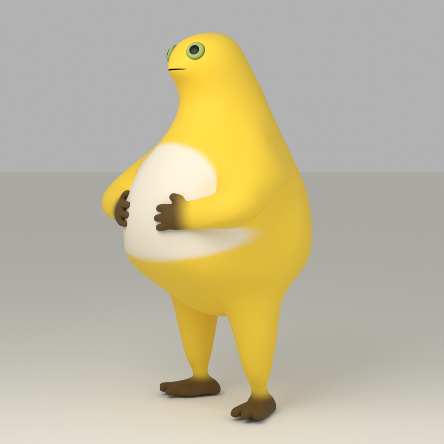
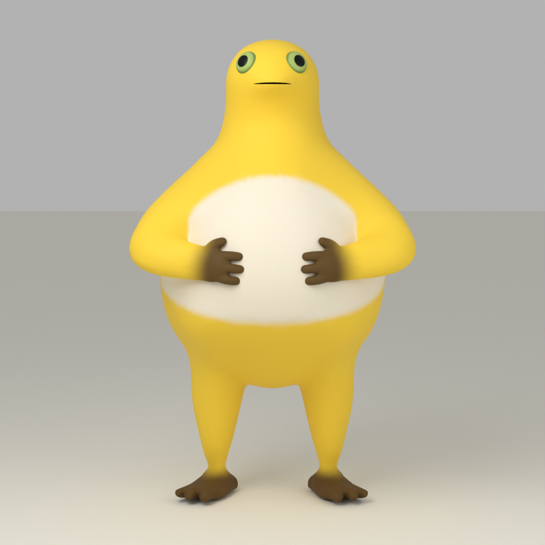
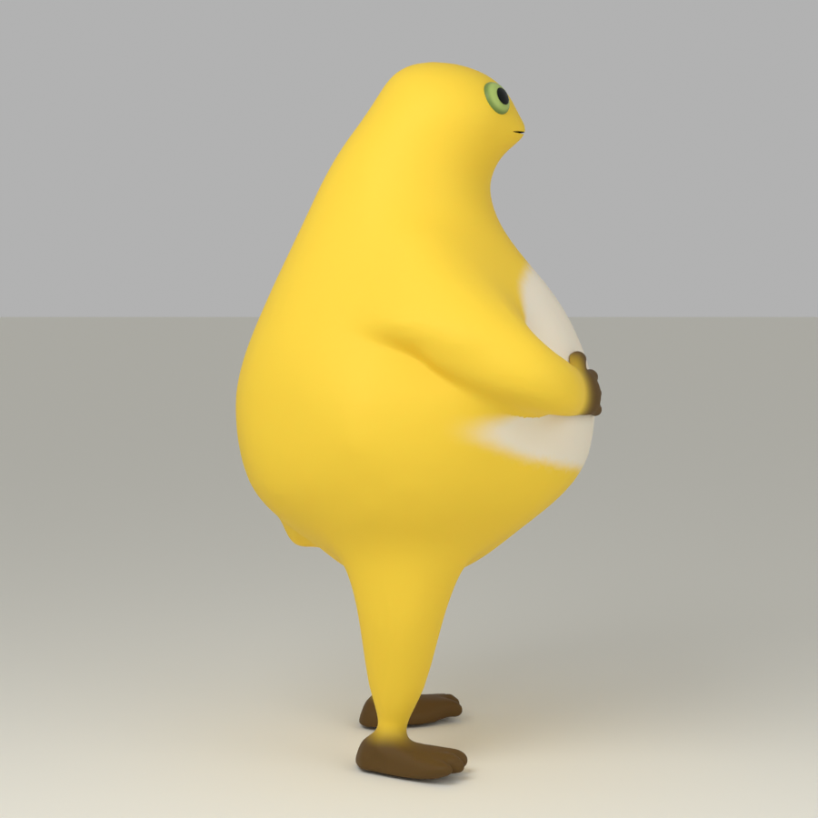
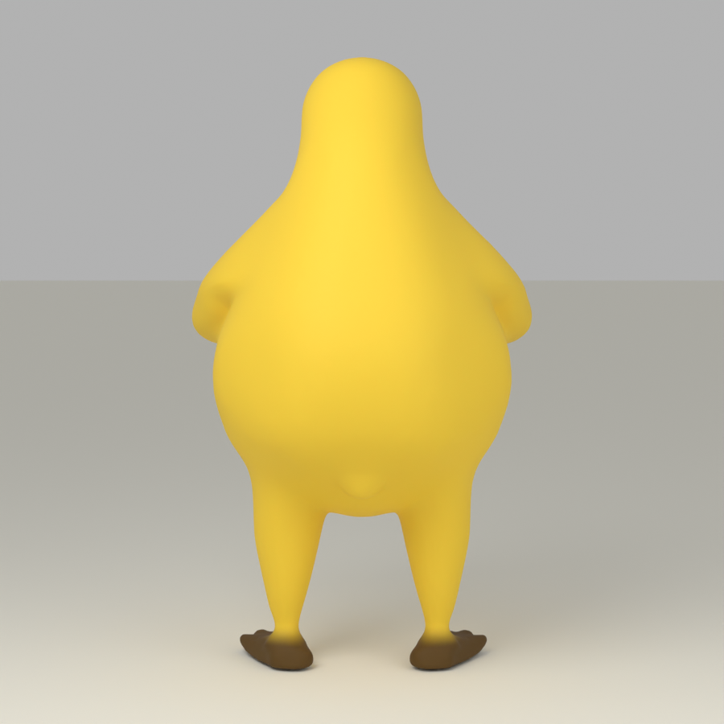

# 奶蛙 · 静态 3D 模型

一个黄色、圆肚子的奶蛙静态模型，提供可编辑的 **Blender 源文件**、通用 **GLB 模型**和可旋转的网页预览。

**[在线旋转预览 →](https://gyz6666.github.io/naiwa-static-model/)**

**仅供学习、练习和非商业使用**；具体使用范围见 [LICENSE.md](LICENSE.md)。



## 下载与查看

- [Blender 源文件](naiwa-refined.blend)：继续编辑模型、材质和场景。
- [GLB 模型](naiwa-refined.glb)：导入支持 glTF 2.0 的三维软件或网页项目。
- [离线网页](index.html)：下载仓库后，用支持 WebGL 与 ES Modules 的现代浏览器打开 `index.html`。模型和运行依赖已内嵌，不需要联网下载第三方资源。

在 GitHub 上点击 **Code → Download ZIP** 可以下载完整仓库；单个模型文件可在文件页点击下载按钮。

网页支持拖动旋转、正面/侧面/背面切换、自动旋转和模型下载。页面只显示角色名称及图标按钮。

## 这一版做了什么

- 修整头脸、颈肩、腹部和腿根轮廓，增加肚子的前后厚度。
- 对称调整双手，保留静态捧腹姿势，修圆脚趾。
- 调亮黄色皮肤，调整奶白肚皮的轮廓与过渡。
- 平滑细小表面起伏，重新协调背部和臀部曲面。

这是非官方同人模型。比例和细节仍有可改进之处。

**本仓库只包含静态版本：没有骨骼、动作片段、音轨或笑声。** 网页的自动旋转仅用于观察模型。文件中保留的少量形态键不是成套动画绑定。

## 四个方向

| 正面 | 侧面 | 背面 |
| --- | --- | --- |
|  |  |  |

## 文件与编辑

| 文件 | 用途 |
| --- | --- |
| `naiwa-refined.blend` | Blender 5.2.2 保存的可编辑场景，包含模型、相机和灯光 |
| `naiwa-refined.glb` | glTF 2.0 模型，使用顶点颜色和材质，不依赖外部贴图 |
| `index.html` | 已打包的单文件旋转预览 |
| `viewer.js` / `viewer.template.html` | 可编辑的预览页面源码 |
| `build_preview.py` | 使用 Python 3 标准库重新打包网页 |
| `three.*.js` / `GLTFLoader.js` / `BufferGeometryUtils.js` | Three.js 0.180.0 运行依赖 |
| `manifest.json` | 模型信息与文件 SHA-256 校验值 |

修改预览源码后，在仓库目录执行：

```sh
python3 build_preview.py
```

需要通过本地网址查看时，可执行：

```sh
python3 -m http.server 8000 --bind 127.0.0.1
```

然后打开 `http://127.0.0.1:8000/`。这些步骤只涉及预览，不会重塑模型。修改模型请在 Blender 中编辑 `.blend`，导出替换 `.glb` 后再重新打包。

## 使用范围

模型与渲染图仅供学习、练习和非商业使用；角色形象权利归相应权利人所有。由于存在非商业限制，本项目是公开分享模型源文件，不是允许任意用途的标准开源模型许可证。

独立的网页预览代码采用 [MIT 许可](LICENSE-CODE.txt)，Three.js 的许可另见 [THREE-LICENSE.txt](THREE-LICENSE.txt)。代码许可不改变模型及角色形象的使用范围。

---

**English:** A static fan-made Naiwa/Nailoong model with editable Blender source, a self-contained GLB and a rotatable HTML viewer. No rig, animation or audio is included. The model and renders are for **learning/practice and non-commercial use**. Character rights remain with their respective owners. The standalone viewer code is MIT-licensed; this does not relicense the model or character IP.
